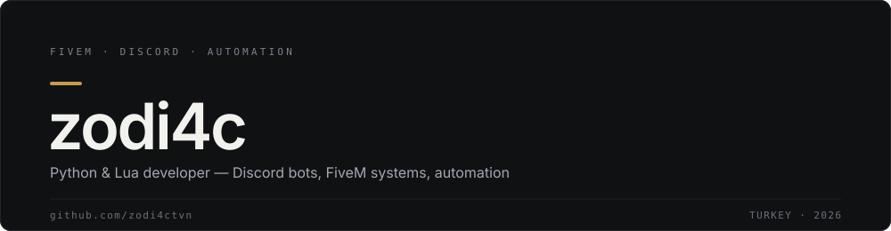

  

Python & Lua developer from Turkey. I build Discord bots, FiveM systems and small
automation tools — the kind that keep running quietly in the background.

---

### Selected work

**[zodi4c-storage](https://github.com/zodi4ctvn/zodi4c-storage)**
Shared storage system for QBCore and Qbox (QBX) servers. Players create their own
storages, share them by password or membership, and store items through `ox_inventory`.
Full NUI interface, activity logs and a bilingual Turkish/English front end.

`Lua` · `FiveM` · `ox_inventory` · `MySQL`

**[coc-bb-autoattack](https://github.com/zodi4ctvn/coc-bb-autoattack)**
Automation for Clash of Clans builder base attacks.

`Python`

### Stack

| | |
| --- | --- |
| Languages | `Python` `Lua` `JavaScript` `SQL` |
| Backend | `discord.py` `Node.js` `MySQL` |
| Game | `FiveM` `QBCore` `Qbox (QBX)` `ox_inventory` |
| Tools | `Git` `VS Code` `Linux` |

### Currently

- Maintaining **[zodi4c-storage](https://github.com/zodi4ctvn/zodi4c-storage)** and its
  documentation.
- Writing more FiveM resources.
- Open to small, well-scoped automation work.

### Elsewhere

[Discord](https://discord.com/users/1350881372104949903) ·
[guns.lol/zodi4c](https://www.guns.lol/zodi4c)

© 2026 zodi4c
